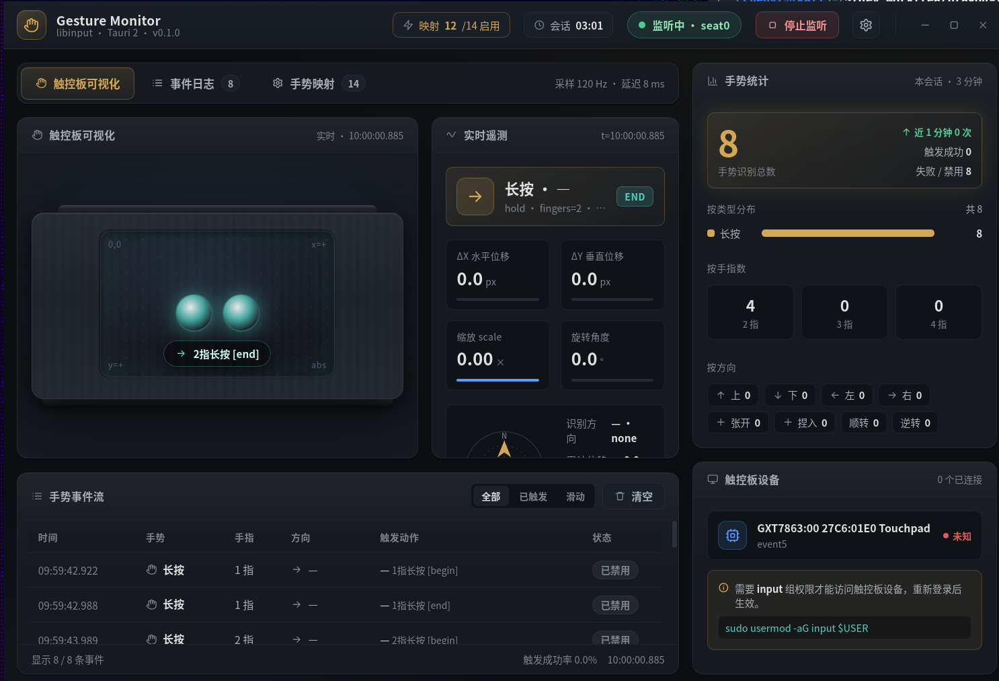

# Gesture Monitor

A Linux touchpad gesture monitor and mapper built with Tauri 2 + React. Detects touchpad gestures in real-time with visual feedback, and supports mapping gestures to system actions such as workspace switching, zooming, and Mission Control.



> Main window: the virtual touchpad visualizes finger positions and gesture trajectories in real time, alongside the gesture event stream, mapping config, device list and statistics.

## Features

- **Real-time Gesture Detection** — Identifies swipe, pinch, rotate, and hold gestures via libinput
- **Visual Animation** — Finger positions and gesture trajectories animated on a virtual touchpad
- **Gesture Mapping** — Bind gestures to system commands; defaults mimic macOS gesture behavior
- **Event Log** — Records gesture event stream with statistics and clear functionality
- **Device Management** — Auto-detects connected touchpad devices
- **System Tray** — Background resident with one-click start/stop and show/hide window
- **Persistent Config** — Mapping rules saved to `~/.config/gesture-monitor/mappings.json`

## Supported Gestures

| Gesture | Fingers | Direction | Default Action |
|---------|---------|-----------|----------------|
| Swipe | 3/4 | Up | Mission Control |
| Swipe | 3/4 | Down | App Exposé |
| Swipe | 3/4 | Left | Previous Workspace |
| Swipe | 3/4 | Right | Next Workspace |
| Pinch | 2 | Pinch In | Zoom Out (Ctrl+-) |
| Pinch | 2 | Pinch Out | Zoom In (Ctrl++) |
| Rotate | 2 | Clockwise | Next Tab (disabled by default) |
| Rotate | 2 | Counter-CW | Previous Tab (disabled by default) |
| Hold | 3 | — | Right Click |
| Hold | 4 | — | Show Desktop |

## Tech Stack

| Layer | Technology |
|-------|------------|
| Frontend | React 18 + TypeScript |
| Styling | Tailwind CSS |
| Build Tool | Vite |
| Desktop Framework | Tauri 2.x |
| Gesture Recognition | libinput (`input` crate) |
| Device Discovery | udev (`udev` crate) |
| Action Execution | xdotool |
| Icons | Lucide React |

## Project Structure

```
gesture-monitor/
├── src/                          # Frontend source
│   ├── App.tsx                   # Main application
│   ├── main.tsx                  # Entry point
│   ├── styles/app.css            # Global styles
│   └── components/
│       ├── TitleBar.tsx          # Title bar
│       ├── TouchpadVisualization.tsx  # Touchpad visualization
│       ├── GestureLog.tsx        # Event log
│       ├── GestureStats.tsx      # Statistics panel
│       ├── GestureCard.tsx       # Gesture event card
│       ├── DeviceList.tsx        # Device list
│       └── GestureMappings.tsx   # Mapping configuration
├── src-tauri/                    # Rust backend
│   ├── src/
│   │   ├── main.rs              # Entry + system tray
│   │   ├── gesture.rs           # libinput gesture listener
│   │   ├── commands.rs          # Tauri commands
│   │   └── actions.rs           # Gesture mapping & action execution
│   ├── Cargo.toml
│   └── tauri.conf.json
├── Makefile                      # Build & service management
├── package.json
├── tailwind.config.js
├── vite.config.ts
└── tsconfig.json
```

## Prerequisites

- **OS:** Linux (libinput support required)
- **Rust:** 1.70+
- **Node.js:** 18+
- **System Dependencies:**
  - `libinput` development library
  - `libudev` development library
  - `webkit2gtk-4.1` (Tauri dependency)
  - `xdotool` (gesture action execution)

### Debian/Ubuntu — Install System Dependencies

```bash
sudo apt install libinput-dev libudev-dev libwebkit2gtk-4.1-dev xdotool
```

### User Permissions

Add your user to the `input` group to access touchpad devices:

```bash
sudo usermod -aG input $USER
```

**Log out and back in for changes to take effect.**

## Quick Start

### Install Dependencies

```bash
make install
```

### Development Mode

```bash
make dev
```

This starts the app with hot-reload for frontend changes and auto-recompile for Rust code.

### Build Release

```bash
make build
```

The release binary is located at `src-tauri/target/release/gesture-monitor`.

### Run Built Binary

```bash
make start    # Run in background
make stop     # Stop
make restart  # Restart
make status   # Check status
```

## Configuration

Gesture mappings are stored in `~/.config/gesture-monitor/mappings.json`. You can edit them through the app's "Gesture Mappings" panel or manually edit the JSON file.

Each mapping rule contains:

```json
{
  "id": "m001",
  "key": {
    "gesture_type": "swipe",
    "finger_count": 3,
    "direction": "up"
  },
  "action_name": "Mission Control",
  "action_cmd": "xdotool",
  "action_args": ["key", "ctrl+alt+Up"],
  "macos_equivalent": "Mission Control — Show all windows and workspaces",
  "enabled": true
}
```

## Service Management

```bash
make help       # List all available commands
make logs       # View logs
make clean      # Clean build artifacts
```

## License

MIT
